<p align="center">
  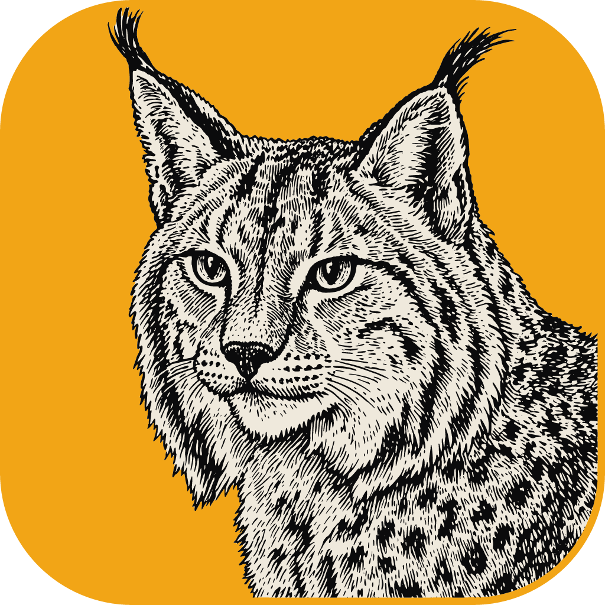
</p>

<h1 align="center">LightCraft for Android</h1>

<p align="center">
  <b>LightCraft-android is an open-source reimplementation of the Adobe Lightroom Android app, created using the same Rust engine, <a href="https://github.com/storytold/lightcraft">LightCraft</a>, as the desktop app, and built with a Kotlin/Jetpack Compose UI framework.</b><br>
  Many credits to the original maintainers, <a href="https://github.com/storytold">storytold</a>.
</p>

<p align="center">
  <a href="https://github.com/artcraft-android/lightcraft-android/releases"></a>
  <a href="https://apps.obtainium.imranr.dev/redirect?r=obtainium://add/https://github.com/artcraft-android/lightcraft-android"></a>
  <br><sub>Each release has two APKs: the plain one for most phones, the <code>-armeabi-v7a</code> one for 32-bit ARM phones.</sub>
</p>

<p align="center">
  
  
  
  
  
  
</p>

<br>

<p align="center">
  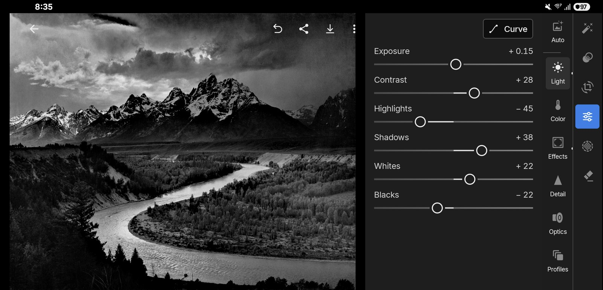
  <br>
  <sub><i>Ansel Adams, "The Tetons and the Snake River" (1942). Public domain, U.S. National Archives. Developed in LightCraft for Android.</i></sub>
</p>

<br>

<p align="center">
  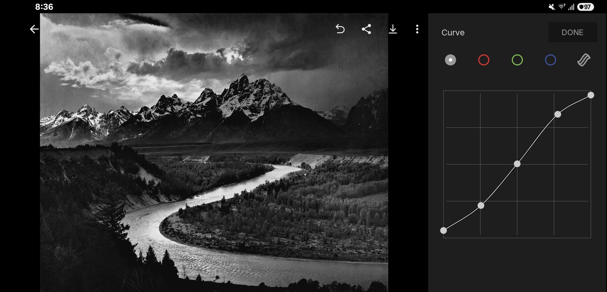
  <br>
  <sub>A gentle S on the RGB point curve, drawn right over the photo. <i>Ansel Adams, 1942 (public domain).</i></sub>
</p>

<br>

## Color grading

<p align="center">
  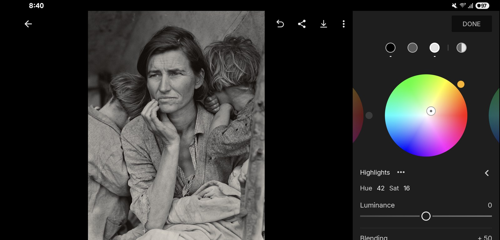
  <br>
  <sub>The Highlights wheel in the Color panel's Grading. <i>Dorothea Lange, "Migrant Mother" (1936). Public domain, Library of Congress.</i></sub>
</p>

<br>

## Before & after

<table>
<tr>
<td width="50%">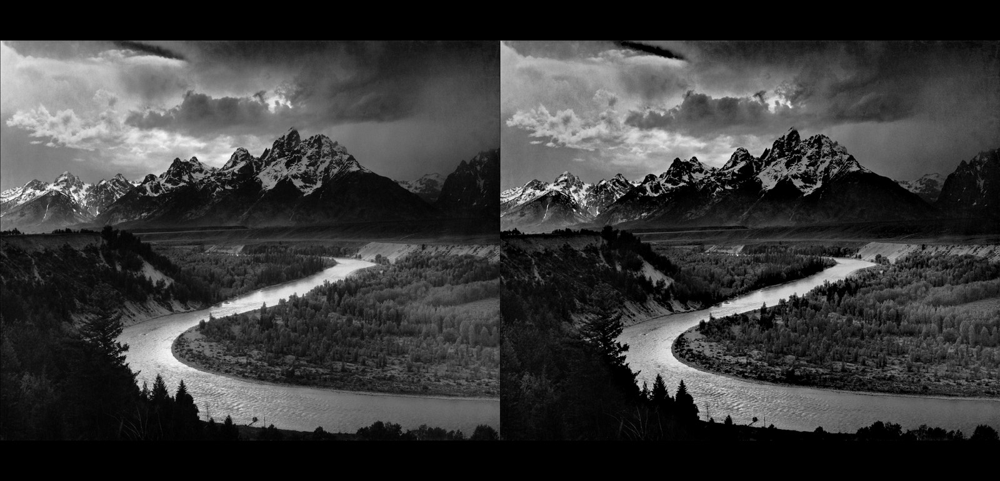<br><sub><b>The Tetons and the Snake River.</b> Highlights −45, Shadows +38, Clarity +28, Dehaze +18. <i>Ansel Adams, 1942 (public domain).</i></sub></td>
<td width="50%">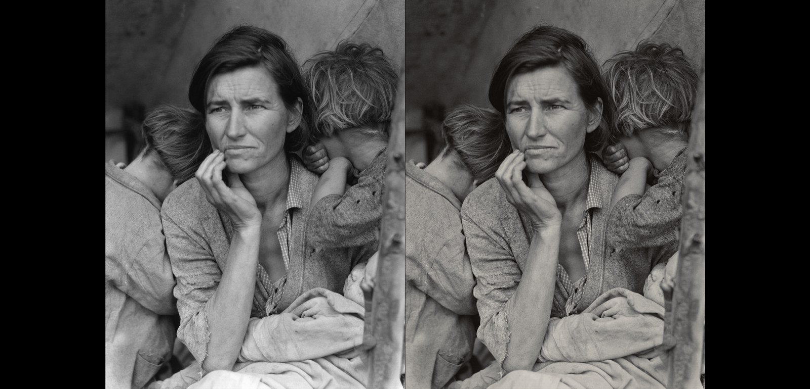<br><sub><b>Migrant Mother.</b> Shadows +42, Texture +18, split-toned grade, vignette. <i>Dorothea Lange, 1936 (public domain).</i></sub></td>
</tr>
<tr>
<td width="50%">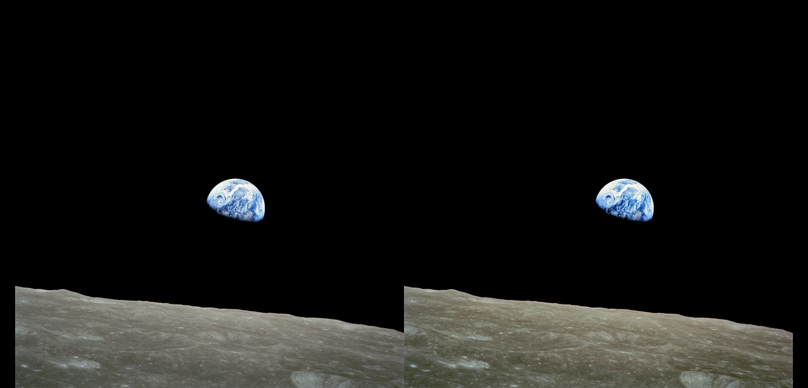<br><sub><b>Earthrise.</b> Dehaze +22, Highlights −30, warmer white balance, Vibrance +22. <i>NASA / Bill Anders, Apollo 8, 1968 (public domain).</i></sub></td>
<td width="50%">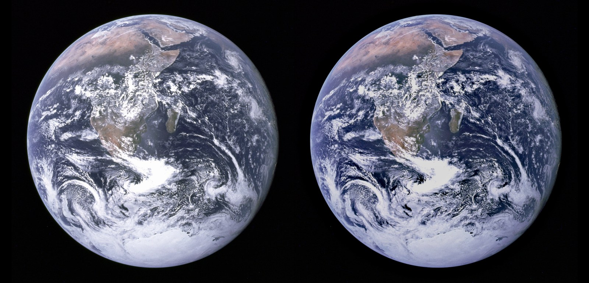<br><sub><b>The Blue Marble.</b> Highlights −38, Blacks −20, Dehaze +15, Vibrance +30. <i>NASA, Apollo 17, 1972 (public domain).</i></sub></td>
</tr>
</table>

<br>

## Masking

<p align="center">
  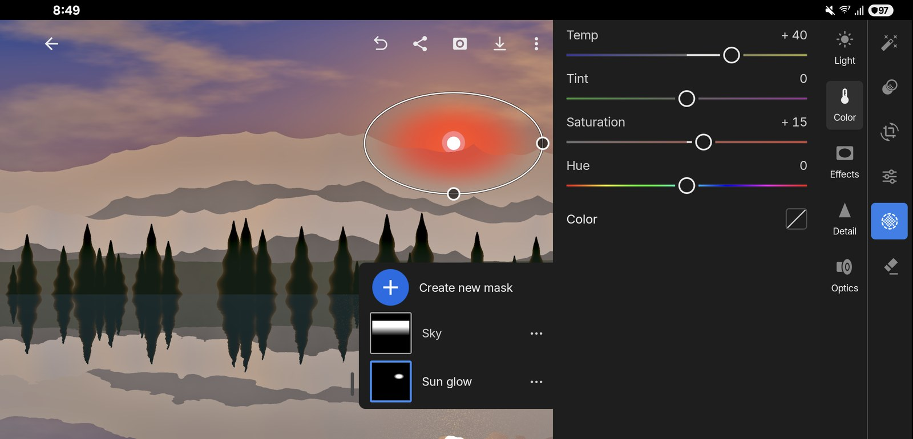
  <br>
  <sub>A radial sun-glow mask (Temp +40, Exposure +0.5) layered over a linear sky mask (Exposure −0.6, Dehaze +20). <i>Photo from LightCraft's procedurally generated demo library.</i></sub>
</p>

<br>

## Presets, profiles & the Color Mixer

<table>
<tr>
<td width="50%">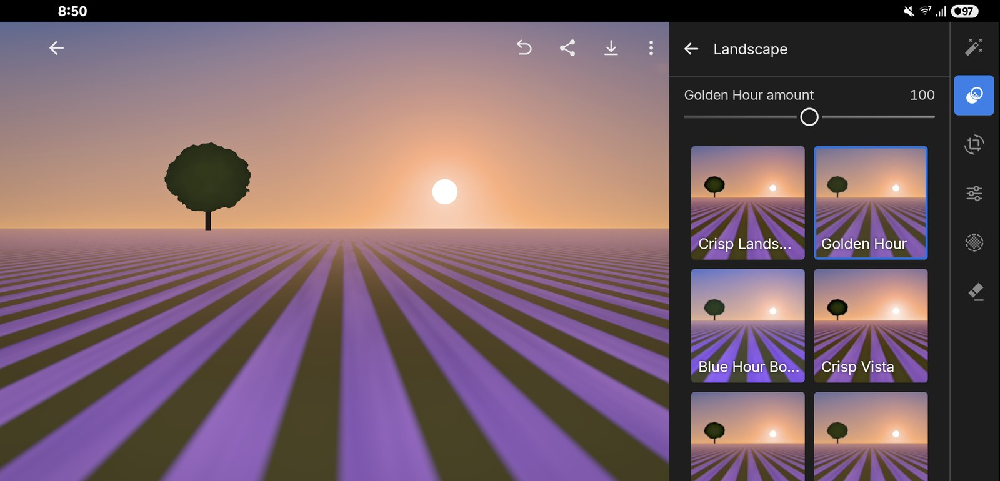<br><sub>The Presets panel: Golden Hour at 100 %, each preset previewed on the photo. <i>Demo library.</i></sub></td>
<td width="50%">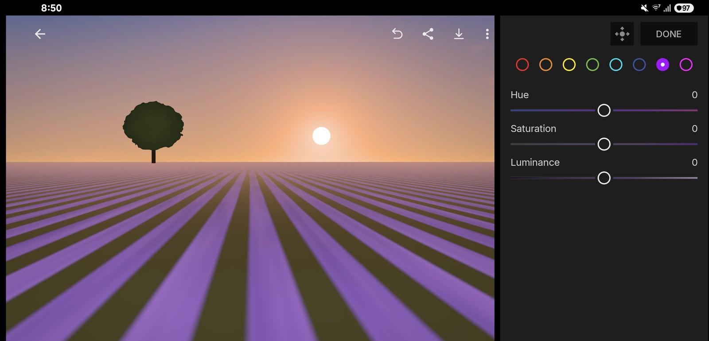<br><sub>The 8-band Mix, open on purple. <i>Demo library.</i></sub></td>
</tr>
</table>

<table>
<tr>
<td width="50%">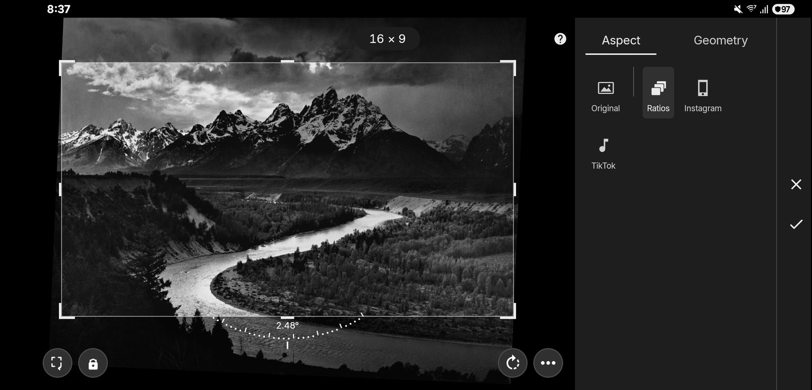<br><sub>A 16:9 crop straightened +2.5°. <i>Ansel Adams, 1942 (public domain).</i></sub></td>
<td width="50%">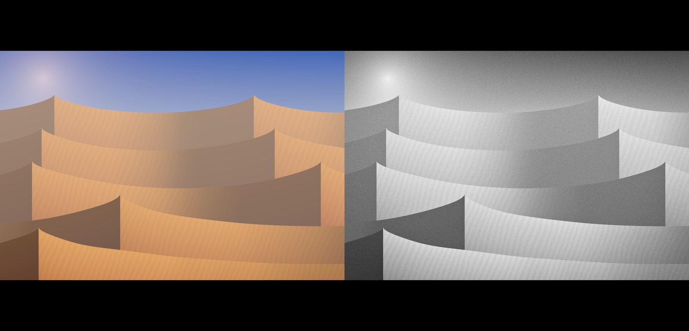<br><sub>The colour original on the left; the High Contrast B&W preset with Vignette and Grain on the right. <i>Demo library.</i></sub></td>
</tr>
</table>

<br>

## Organization

<table>
<tr>
<td width="50%">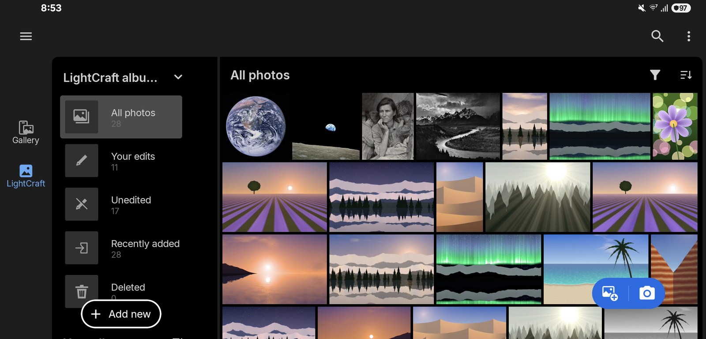<br><sub>The library sideways: the grid beside the views and albums. <i>Demo library.</i></sub></td>
<td width="50%">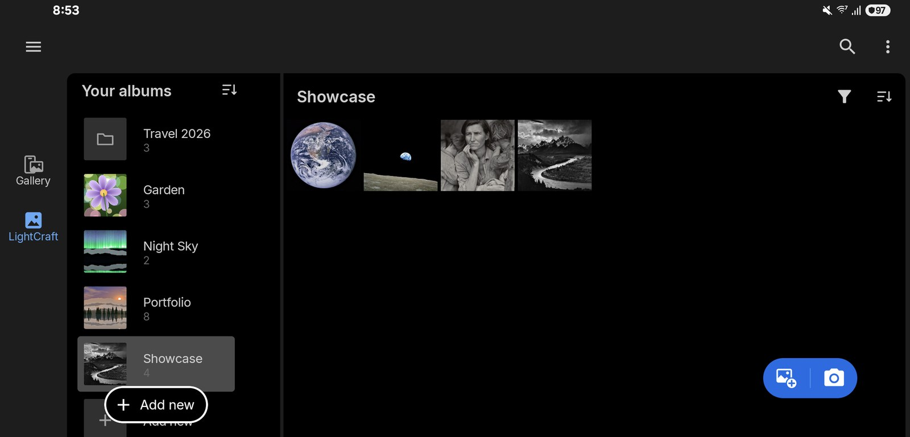<br><sub>Square grid of the four public-domain showcase photos.</sub></td>
</tr>
<tr>
<td colspan="2">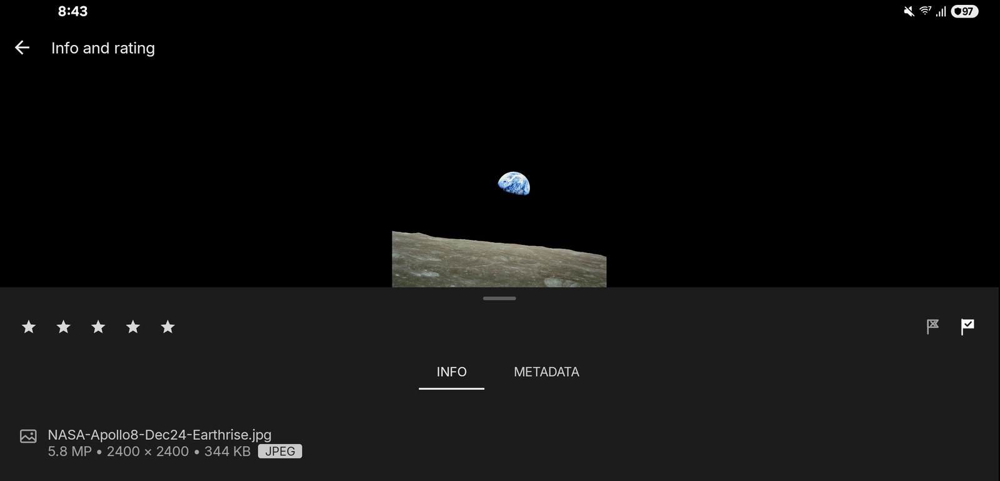<br><sub>More › Info and rating: the rating, the flags and the photo's file, size and format. <i>NASA / Bill Anders, "Earthrise", Apollo 8, 1968 (public domain).</i></sub></td>
</tr>
</table>

<br>

## How it's organized

<table>
<tr>
<td width="50%">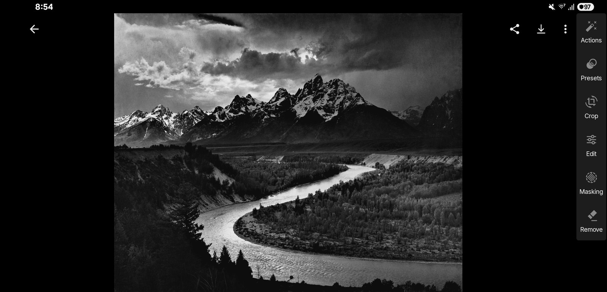<br><sub>The editor: the photo, and its six tools in a column at the edge. <i>Ansel Adams, 1942 (public domain).</i></sub></td>
<td width="50%">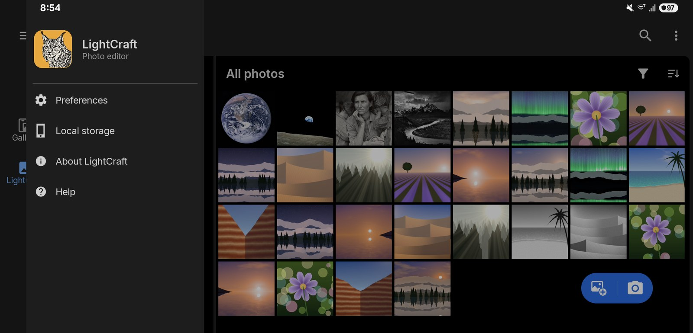<br><sub>The library's menu: Preferences, Local storage, About and Help.</sub></td>
</tr>
<tr>
<td colspan="2">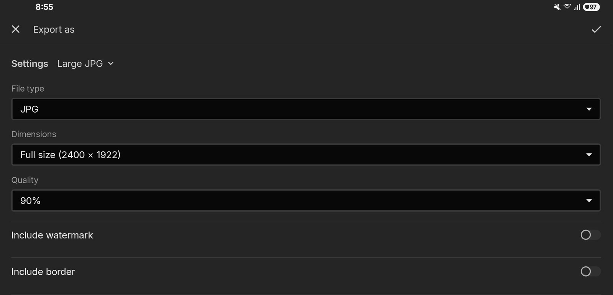<br><sub>Export as, from the editor's download button (or Share › Export as…): the settings, file type, size, quality, watermark and border.</sub></td>
</tr>
</table>

<br>

## Planned features

LightCraft for Android is in beta.

| Area | Status |
|---|---|
| Library: views, albums (create, rename, delete, cover), filter, sort, search, select mode, justified and square grids, date segments, slideshow | ✅ |
| Import: photo picker, files (raws), camera, Share from other apps; the Gallery tab (the phone's photos) | ✅ |
| Light, Color (white balance, eyedropper), Mix, Grading, Effects, Detail, Optics, Tone Curve (+ targeted) | ✅ |
| Profiles and presets (with amount), copy and paste settings | ✅ |
| Crop (ratios, Instagram and TikTok formats), straighten, Upright, turns and flips, manual transforms | ✅ |
| Masking: brush, linear, radial, colour and luminance range (a point or an area), add and subtract, each part's menu, a colour tint | ✅ · AI masks (subject, sky) ⬜ |
| Remove, heal and clone spots | ✅ |
| Save or share: JPG, TIF, AVIF (DNG for raws) or the original; small, full or custom size; quality, naming, sharpening, colour space, metadata, watermark and border | ✅ |
| Upright and sideways layouts | ✅ |
| Lens blur | ⬜ (the engine doesn't render it yet) |
| Community, cloud sync | 🚫 LightCraft is a local app |

<sub>✅ works today · 🚧 in progress · ⬜ not started · 🚫 not planned</sub>

<br>

## Building Instructions
*One Gradle command builds the whole app: it compiles the Rust engine with [cargo-ndk](https://github.com/bbqsrc/cargo-ndk) and generates the Kotlin bindings.*

* Clone this repository
* Make sure you have at least 3 GB of free disk space
* enter `apps/lightcraft-android/android` and run `./gradlew assembleRelease`, or open that folder in Android Studio and press Run.

Build time dependencies:

<details>
  <summary>required tools</summary>

  ```
      Rust 1.90 or newer
      rustup target add aarch64-linux-android x86_64-linux-android
      rustup target add armv7-linux-androideabi   (only for 32-bit ARM builds)
      cargo install cargo-ndk
      Android SDK (API 37) and NDK 29.0.14206865
      JDK 17 or newer
  ```
</details>

*Builds are only tested on Windows 11.*

<br>

## License

[MIT](LICENSE-MIT) OR [Apache-2.0](LICENSE-APACHE), at your option. LightCraft for Android is not affiliated with Adobe;
Lightroom is a trademark of Adobe Inc.

<br>

## Misc info for myself

Try to use [semantic commit](https://kapeli.com/cheat_sheets/Semantic_Commits.docset/Contents/Resources/Documents/index)
messages. Use `feat:` / `fix:` / `chore:` / `docs:` / etc.
